# Kierunek artystyczny: raycast.com → Skibi Labs

Dokument opisuje, co zmierzono we wzorcu, co z niego bierzemy, jak wygląda zestawienie
ekran po ekranie i czego nie dało się sprawdzić bez właściciela.

## 1. Źródła i metoda

| Materiał | Gdzie |
| --- | --- |
| Zrzuty raycast.com co 300 px przewijania, 1440×900 i 390×844 (po 52 kadry) | `art-direction/reference/1440/`, `art-direction/reference/390/` |
| Nagranie przewijania wzorca | `art-direction/reference/scroll-1440.mp4`, `scroll-390.mp4` |
| Stany hover (nawigacja, przycisk) i otwarte menu mobilne | `art-direction/reference/hover-*.jpg`, `menu-open-390.jpg` |
| Style obliczone: kroje i status ładowania, stopnie, grubości, interlinie, światła, kontenery, promienie, kolory, przejścia, animacje | `art-direction/reference/computed-styles.json` |
| Nagranie ekranu z telefonu właściciela (raycast.com, 11,5 s) — klatki | `art-direction/owner/` |
| Zrzuty Skibi Labs, te same szerokości | `art-direction/skibilabs/1440/`, `art-direction/skibilabs/390/` |
| Zestawienia obok siebie | `art-direction/compare/` |
| Nagrania Skibi Labs: przewijanie i użycie demo | `art-direction/skibilabs/scroll-*.mp4`, `demo-1440.mp4` (klawiatura), `demo-390.mp4` (dotyk) |

Wszystko zebrano Playwrightem w headless Chromium, 15 listopada 2026.

## 2. Jak jest naprawdę (a nie z pamięci)

- Tło `#07080a`, tekst biały, jedna skala szarości (`#e6e6e6` … `#0c0d0f`).
- **Krój to Inter** (zmienny, 100–900), pomocniczo Geist Mono i JetBrains Mono. Inter jest
  wolny (OFL), więc nie trzeba było szukać odpowiednika — patrz punkt 5.
- Hero: wyśrodkowany nagłówek 64/70,4 px, grubość 600; podtytuł 18 px; pod spodem **płótno WebGL
  1200×895** z ukośnymi smugami w jednym kolorze, z ziarnem i chłodną obwódką. Smugi się
  poruszają (dwa kadry w odstępie 2,5 s różnią się, RMSE 0,15). Przycisk i dwie linijki
  maszynowym krojem 12 px stoją przy dolnej krawędzi pierwszego ekranu.
- Z nagrania właściciela: na wejściu najpierw pojawia się nagłówek, potem podtytuł, a smugi
  wchodzą jako ostatnie, z rozjaśnieniem. Okno produktu na telefonie jest pomniejszone w całości,
  pod nim stoi rząd pięciu przycisków-zakładek z podpisem nad aktywną, a demo odtwarza się samo.
- **Okno produktu nie stoi w pierwszym ekranie.** Zaczyna się ok. 1150 px niżej, w ramie
  udającej pulpit (pasek menu, tapeta ze smugami), z przełącznikiem widoków i podpisem
  „pierwsze zdanie białe, reszta szara”.
- Nagłówki sekcji są małe: 20 px, grubość 500, dwa zdania — pierwsze białe, drugie szare
  (`#6a6b6c`). Większy nagłówek (32 px) ma tylko sekcja AI, a 56 px — sekcja dla programistów.
- Dalej: klawiatura z czterema „klawiszami-cechami”, karuzela kart rozszerzeń w kolorach marek,
  duże okno czatu z dwiema kartami, opinie (wybór osoby → dwie etykiety maszynowym krojem i cytat
  z wyróżnioną frazą), siatka „bento” (jedna karta szeroka i dwie połówki), przewijany tekst
  z oknem notatek, społeczność, sekcja techniczna z rysunkami izometrycznymi, klawiatura
  z podświetlonym klawiszem jako końcowe wezwanie, stopka ze szczytem smug nad linią.
- **Akcent występuje rzadko**: kolor `#ff6363` jako tekst w 2 miejscach, jako tło w 3, jako
  obramowanie w 6 (pola wyboru w oknie notatek). Poza tym czerwień żyje w smugach.
- Ruch: przejścia 0,2 s `ease-in-out` (hover), 0,3 s `ease` (kolor), 0,4 s
  `cubic-bezier(0.23, 1, 0.32, 1)` (klawisze), wejścia 0,7 s `cubic-bezier(0.215, 0.61, 0.355, 1)`.
- Nawigacja: karta 1204×76 px (58 px na telefonie), 16 px od góry, promień 16 px, obramowanie
  `rgba(255,255,255,.06)`, gradient 137°, rozmycie tła 5 px. Odnośniki 14 px/500, `#9c9c9d`.
- Przycisk: 36 px wysokości, promień 8 px, tło `#e6e6e6`, tekst `#2f3031` 14 px/500, cztery
  cienie (obwódka, poświata, dwa wewnętrzne). Wciśnięty: tło białe.

## 3. Co bierzemy, a czego nie

Bierzemy **system**: tło i skalę szarości, skalę pisma, szerokości kontenerów, promienie,
odstępy, konstrukcję nawigacji i przycisku, rytm sekcji, dwuzdaniowe nagłówki, gatunek tła hero
(ukośne smugi z ziarnem rysowane shaderem), rolę okna produktu, motyw klawiszy, czasy i krzywe.

Nie bierzemy: treści, grafik, ikon, plików krojów ani koloru marki. Smugi są napisane od zera
(`src/lib/streaks/shader.ts`), ikony narysowane własne (`src/components/Icon.astro`), akcent
jest niebieski (`#2947ff` w smugach, `#6ea8ff` w interfejsie) zamiast czerwieni Raycasta.

Świadome odstępstwa:

| Wzorzec | Skibi Labs | Dlaczego |
| --- | --- | --- |
| Szary drugiego zdania `#6a6b6c` (kontrast 3,7:1) | `#85878a` (5,3:1) | WCAG 2.1 AA dla tekstu 20 px/500 |
| Przycisk 36 px | 40 px | cele dotyku ≥ 40 px na każdej szerokości |
| Karty rozszerzeń w kolorach marek | trzy karty w jednej rodzinie niebieskiej | nie mamy cudzych marek; drugi akcent byłby ozdobnikiem |
| Zdjęcia osób i cytaty | zasady pracy | brak podanych referencji — punkt 8 |
| Sekcja z rysunkami izometrycznymi, społeczność, filmy | pominięte | nie mają odpowiednika w ofercie; nie dorabiamy treści |

## 4. Tokeny

Źródło: `src/styles/tokens.css`. Audyt (`tests/audit.mjs`) sprawdza, że każdy tekst na stronie
używa stopnia i grubości z tej listy.

| Token | Wzorzec (pomiar) | Skibi Labs |
| --- | --- | --- |
| Tło | `rgb(7, 8, 10)` | `--bg: #07080a` |
| Szarości | `#e6e6e6 #cdcece #9c9c9d #6a6b6c #434345 #2f3031 #1b1c1e #111214 #0c0d0f` | te same, poza `--grey-300: #85878a` |
| Linie | `rgba(255,255,255,.06)` i `.1` | `--line`, `--line-2` |
| Powierzchnie | `rgba(255,255,255,.02 / .05 / .1)` | `--surface`, `--surface-2`, `--surface-3` |
| Akcent | `#ff6363` | `--accent: #6ea8ff`, w smugach `#1b0e8a → #2947ff → #4f96ff` |
| Nagłówek hero | Inter 64/70,4, 600 (telefon 36/39,6) | `--fs-64`, 600, interlinia 1,1 (telefon `--fs-36`) |
| Podtytuł hero | 18 px, 400, światło 0,2 px (telefon 14 px) | `--fs-18` (telefon `--fs-14`) |
| Nagłówek sekcji | 20 px, 500, światło 0,2 px, dwa kolory | `.duo`: `--fs-20`, 500 |
| Nagłówek duży | 32/38,4, 500, światło −0,8 px | `.h2`: `--fs-32` |
| Tekst | 14/22,4 i 16/25,6, 500 | `.small`, `.body` |
| Okno produktu | 13 i 14 px, 400/500/600 | `--fs-12 … --fs-16` |
| Krój maszynowy | Geist Mono 12/19,2, 400 | `.note`, `.mono` |
| Stopnie pisma | — | 11, 12, 13, 14, 16, 18, 20, 24, 32, 36, 56, 64 px |
| Grubości | 400, 500, 600 | 400, 500, 600 |
| Kontenery | 1204, 1064, 746 px | `--container`, `--container-sm`, `--container-xs` |
| Odstęp siatki | 32 px | `--grid-gap` |
| Promienie | 4, 6, 8, 12, 16, 20 px | `--r-4 … --r-20` |
| Odstępy | 4 … 224 px (skala 4/8) | `--s-4 … --s-224` |
| Nawigacja | 76 px (58 px), 16 px od góry | `--nav-h`, `--nav-top` |
| Ruch | 0,2 / 0,3 / 0,4 / 0,7 s; krzywe jak wyżej | `--t-fast`, `--t-base`, `--t-slow`, `--t-enter`, `--ease-out-expo`, `--ease-out-cubic` |

Akcent w interfejsie Skibi Labs występuje w: etykietach nad nagłówkami (`.eyebrow`), obwódce
fokusu, kursorze pola palety, paskach śladu przepływu, numerach zasad, skrótach commitów,
podświetlonych klawiszach i znaczniku „sprawdzone ponownie”. To więcej miejsc niż we wzorcu
(tam czerwień jest niemal wyłącznie w smugach) — do decyzji właściciela, czy ograniczyć.

## 5. Krój

Wzorzec używa Intera, który jest dostępny na licencji SIL OFL 1.1, więc zestawianie próbek
zamienników nie było potrzebne: używamy tego samego kroju, ale **nie plików wzorca**. Pliki
pochodzą z oficjalnych pakietów (`inter-ui` 4.1.1, `geist` 1.9.2), zostały przycięte do polskiego
zestawu znaków i zakresu grubości 400–600 (Inter 32 kB, Geist Mono 9 kB) i są podawane z tego
samego serwera. Szczegóły i licencje: `assets-src/fonts/SOURCES.md`.

## 6. Storyboard strony głównej

| # | Zrzut wzorca | Plan Skibi Labs | Zasoby i ruch |
| --- | --- | --- | --- |
| 1 | `reference/1440/scroll-000-y0.jpg` — hero | Nagłówek „Zaplecze dla agentów AI.”, podtytuł z trzema filarami, przycisk „Umów rozmowę”, dwie linijki maszynowym krojem | Shader WebGL (`streaks/`), plakat `public/art/hero-*.webp` z tego samego shadera; wejście tła 1,4 s; pętla stoi poza kadrem i przy `prefers-reduced-motion` |
| 2 | `scroll-004-y1200.jpg` — okno produktu w ramie pulpitu | Konsola z paletą poleceń w ramie „sesji”, przełącznik czterech widoków, podpis pod oknem | `lib/console/`; autoodtwarzanie do pierwszego dotknięcia; skrypt ładowany, gdy okno zbliża się do ekranu |
| 3 | `scroll-008-y2400.jpg` — klawiatura z cechami | „Nie chodzi o to, żeby mieć agenta.” + cztery klawisze-zasady | CSS; wejście sekcji 0,7 s |
| 4 | `scroll-011-y3300.jpg` — karty rozszerzeń | Trzy filary jako karty: ściana słów, fragment kodu, stany ustalenia | CSS i SVG; na telefonie przewijany wiersz z przyciąganiem |
| 5 | `scroll-015-y4500.jpg` — duże okno i karty | „Od rozmowy do systemu, który działa”: okno repozytorium i trzy etapy | HTML; inny widok produktu niż konsola |
| 6 | `scroll-021-y6300.jpg` — opinie | „Zamiast opinii — zasady”: wybór zasady → dwie etykiety i zdanie z wyróżnioną frazą | CSS bez JS (pola wyboru); przejście 0,7 s |
| 7 | `scroll-025-y7500.jpg` — bento | „Co dostajesz do ręki”: historia zmian, fragment raportu, skróty konsoli | `public/art/card-wide.webp` + HTML |
| 8 | `scroll-048-y14400.jpg` — klawiatura z poświatą | „Zacznij od rozmowy.” nad rzędami klawiszy z podświetlonym `/` i `enter` | CSS |
| 9 | `scroll-051-y15032.jpg` — stopka | Szczyt smug nad linią, trzy kolumny odnośników, dane firmy | `public/art/footer.webp` |

Podstrony (`/agenci/`, `/automatyzacja/`, `/bezpieczenstwo/`, `/konsola/`, `/jak-pracujemy/`,
`/kontakt/`, `/polityka-prywatnosci/`, 404) dzielą jeden układ: etykieta maszynowym krojem,
nagłówek 56 px, wstęp, a pod nim figura właściwa tylko dla tej strony.

## 7. Rodzina grafik

Jedna rodzina: ukośne smugi światła z ziarnem, rysowane jednym shaderem
(`src/lib/streaks/shader.ts`). Hero rysuje je na żywo, pozostałe miejsca używają kadrów
zapisanych tym samym kodem (`npm run art` → `public/art/*.webp`, razem 75 kB). Zdjęć nie ma.

Produkt pojawia się w pięciu miejscach i w każdym pokazuje co innego:

| Miejsce | Widok |
| --- | --- |
| Scena na stronie głównej, `/konsola/` | działająca konsola: paleta i trzy widoki wyniku |
| Karty filarów | ściana nazw składników, kod przepływu, stany ustalenia |
| Sekcja procesu | drzewo repozytorium i plik przepływu z wynikami kontroli |
| „Co dostajesz” | historia zmian, pojedyncze ustalenie z raportu, trzy klawisze |
| Podstrony filarów | schemat środowiska agenta, zmiana w kodzie z testami, tabela ustaleń |

## 8. Dowody społeczne i ich zamienniki

Wzorzec ma w tym miejscu zdjęcia, nazwiska i cytaty znanych osób. Właściciel zaznaczył, że ma
referencje, ale ich treści nie podał, więc **na stronie nie ma żadnego logotypu, cytatu, liczby
klientów, certyfikatu ani wzmianki prasowej**. Układ sekcji został, treść jest inna:

- zamiast osób — trzy zasady pracy („Dane zostają u Ciebie”, „Tyle uprawnień, ile trzeba”,
  „Testy tylko za zgodą”);
- zamiast „ulubionej funkcji” i „rozszerzenia” — „Co dostajesz” i „Po czym poznasz”;
- zamiast cytatu — jedno zdanie zasady z wyróżnioną frazą, bez cudzysłowów.

Te zdania są zobowiązaniami firmy. Wynikają z opisu filarów w zamówieniu, ale właściciel
powinien je przeczytać i potwierdzić. Gdy poda referencje, wystarczy uzupełnić `references`
w `src/config/company.ts` i dopisać ich wyświetlanie w tej sekcji.

## 9. Zestawienia

Lewa strona: raycast.com, prawa: Skibi Labs, ta sama szerokość okna.

| Fragment | 1440 px | 390 px |
| --- | --- | --- |
| Hero | 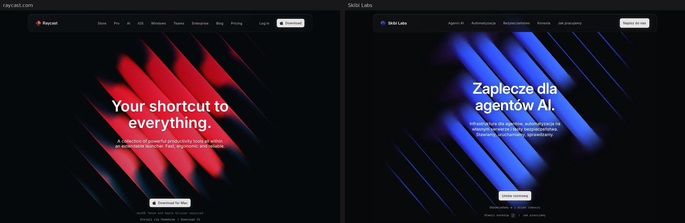 | 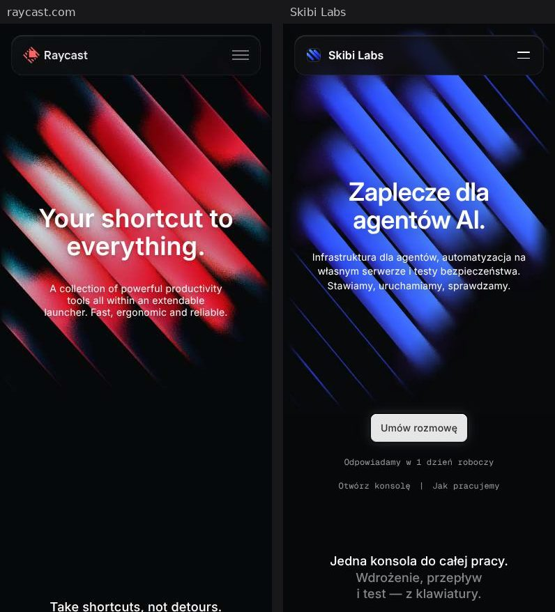 |
| Demo produktu | 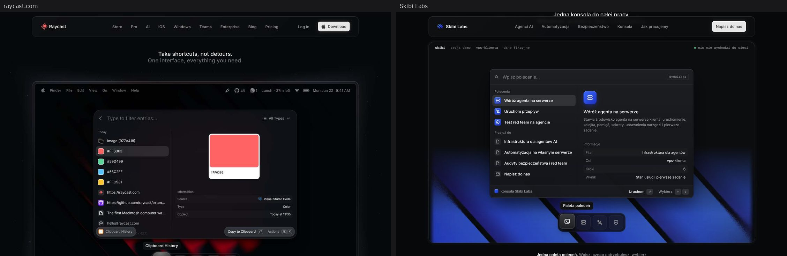 | 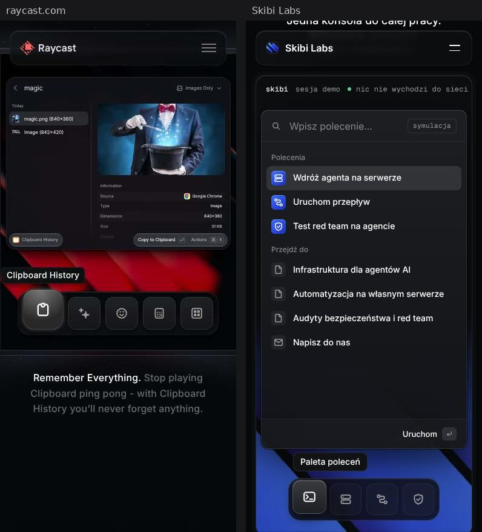 |
| Funkcje: klawisze | 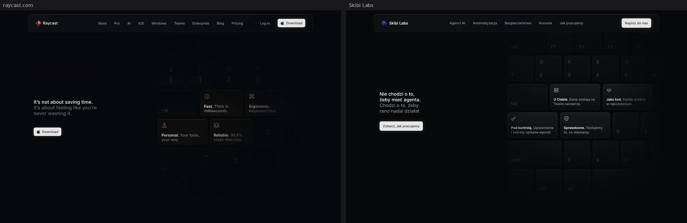 | 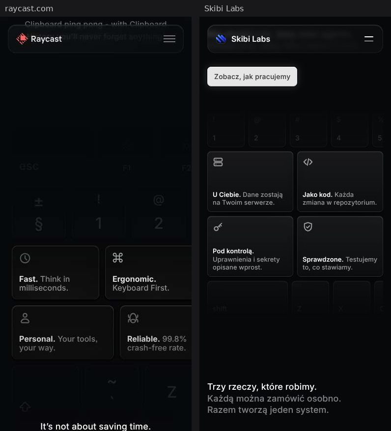 |
| Funkcje: karty | 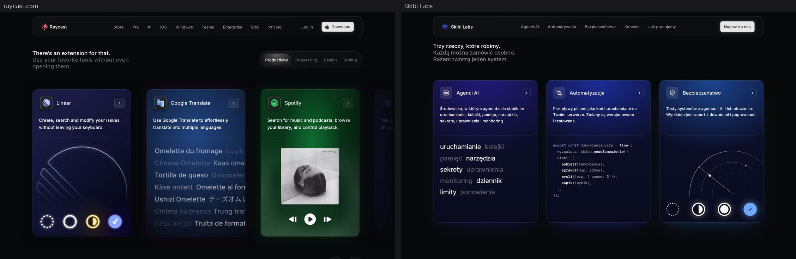 | 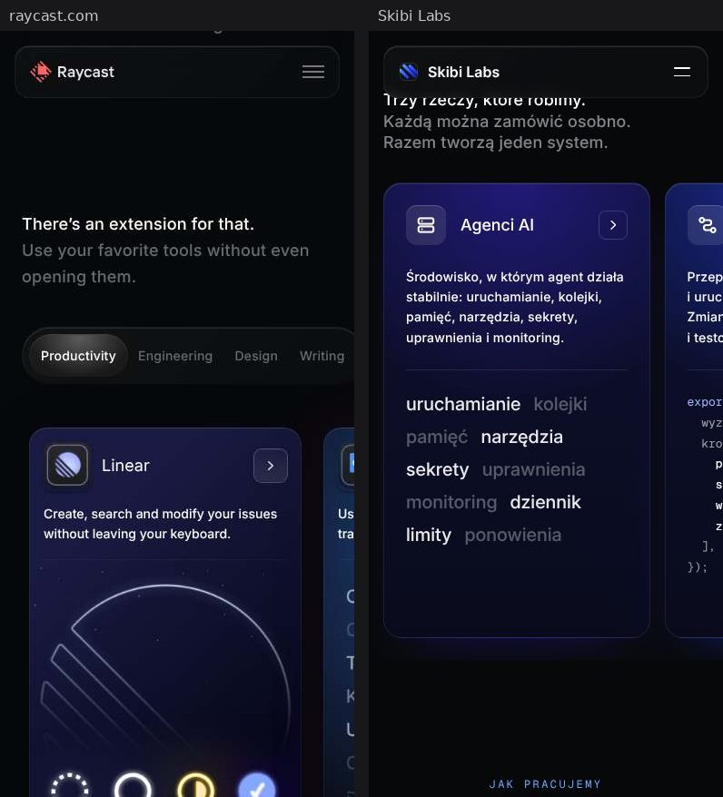 |
| Funkcje: duże okno | 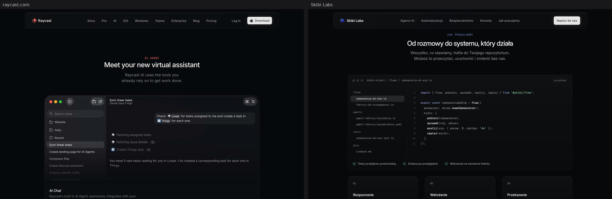 | 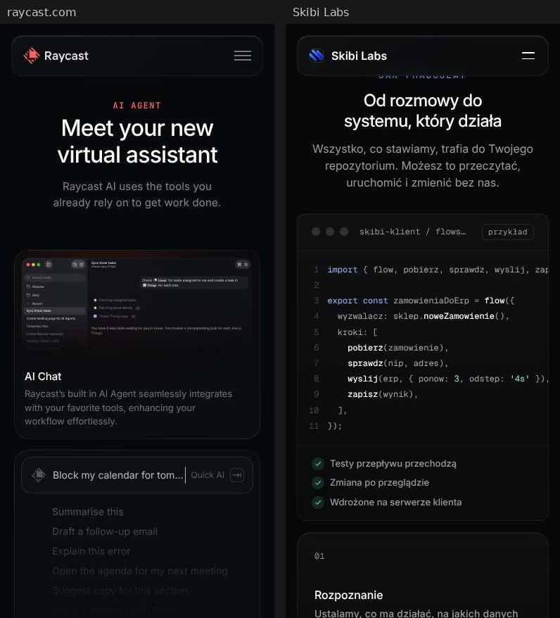 |
| Dowody społeczne → zasady | 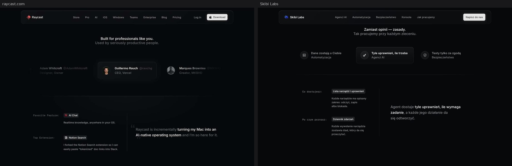 | 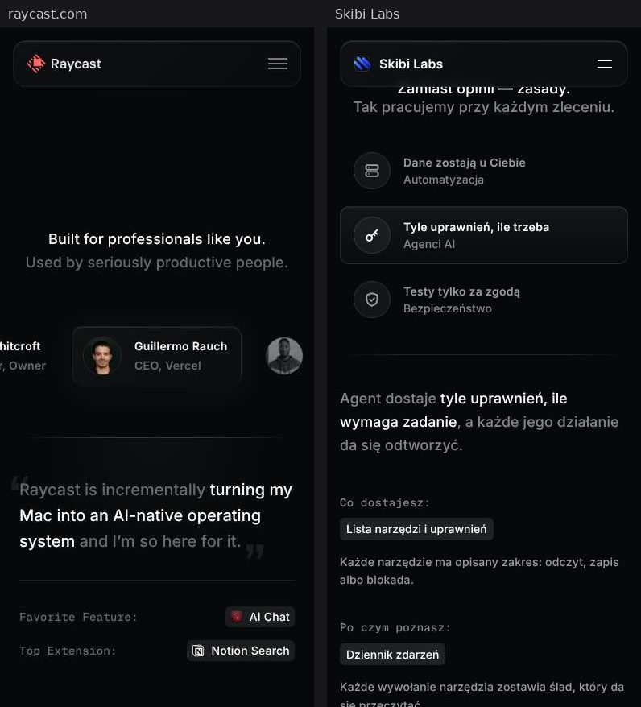 |
| Funkcje: bento | 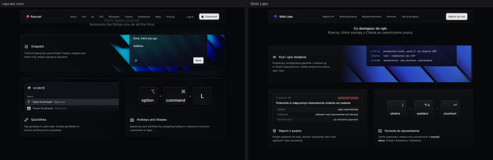 | 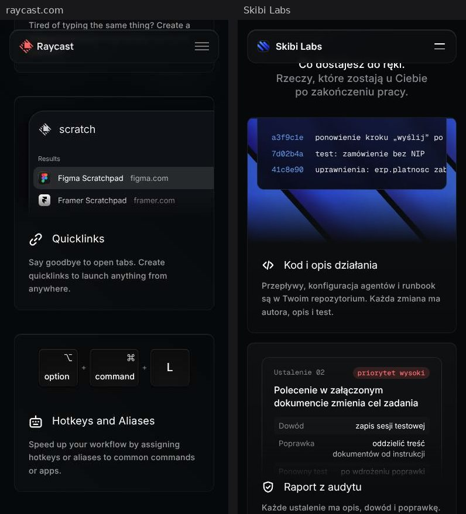 |
| Końcowe wezwanie | 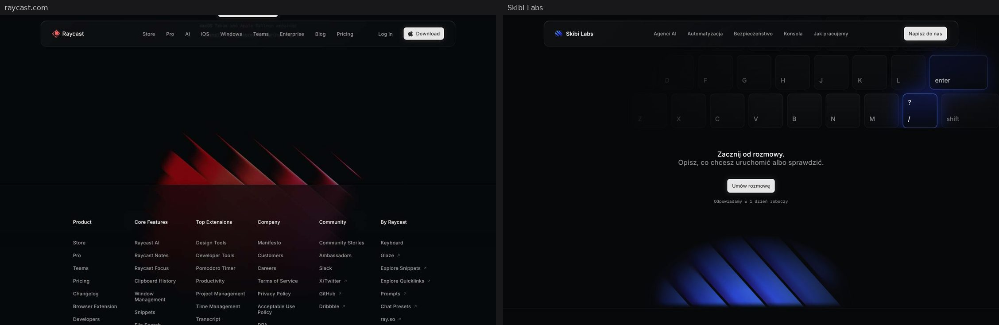 | 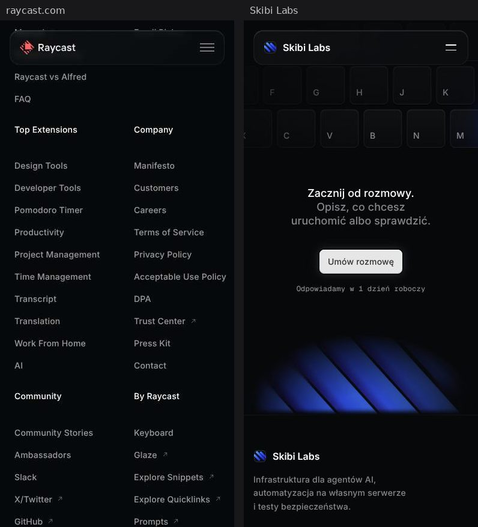 |

Widoki wyniku konsoli: `art-direction/skibilabs/1440/konsola-deploy.jpg`, `konsola-flow.jpg`,
`konsola-redteam.jpg` (i te same w `390/`).

Co po zestawieniu nadal odstaje od wzorca:

- Smugi wzorca mają bardziej „fotograficzne” rozmycie końców; nasze są gładsze i bardziej
  regularne. W ruchu różnicę widać mniej niż na kadrze.
- Wzorzec na telefonie pomniejsza całe okno produktu. My przebudowujemy układ okna, żeby tekst
  był czytelny i cele dotyku miały 40 px — okno jest przez to wyższe.
- Strona wzorca jest dwa razy dłuższa (ok. 15 900 px przy 1440 px, nasza ok. 8 000 px), bo ma
  sekcje, dla których nie mamy treści.

## 10. Demo produktu

Konsola (`src/lib/console/`) to symulacja: dane są fikcyjne, nic nie wychodzi do sieci,
w scenariuszu red team są tylko nazwy i opisy klas problemów.

- `data.ts` — polecenia i trzy scenariusze; `model.ts` — stan i przejścia bez DOM;
  `templates.ts` — HTML jako funkcja stanu; `client.ts` — klawiatura, dotyk, zegar.
- Build renderuje stan początkowy tymi samymi funkcjami, więc po załadowaniu skryptu nic się
  nie przesuwa (CLS 0).
- Klawiatura: `/` albo `Ctrl/⌘ K` otwiera, strzałki wybierają, `Enter` uruchamia / pokazuje
  wynik / uruchamia ponownie, `Esc` wraca. Dotyk: lista, wiersze wyniku, przyciski w stopce
  okna i przełącznik pod oknem.
- Trzy widoki wyniku są różne: lista kroków z panelem usług i uprawnień; oś czasu z błędem,
  odczekaniem i ponowieniem; lista prób z licznikiem i panelem ustalenia.

## 11. Pomiary

Lighthouse 13.6 (mobile, domyślne dławienie), headless Chromium, serwer lokalny z kompresją Brotli:

| Strona | Wydajność | Dostępność | Dobre praktyki | SEO | LCP | CLS | TBT |
| --- | --- | --- | --- | --- | --- | --- | --- |
| `/` | 100 | 100 | 100 | 66 / 100* | 0,8 s | 0 | 0–30 ms |
| `/konsola/` | 100 | 100 | 100 | 66 / 100* | 1,6 s | 0 | 0 ms |
| `/polityka-prywatnosci/` | 100 | 100 | 100 | 66 / 100* | 1,4 s | 0 | 0 ms |

\* 66 w buildzie roboczym, bo strona celowo ma `noindex`, dopóki właściciel nie potwierdzi danych
firmy; 100 w buildzie publikacyjnym (`SITE_PUBLISH=1`), sprawdzone na stronie głównej.

Uwaga do wydajności: w headless nie ma akceleracji sprzętowej, więc przeglądarka odmawia
kontekstu WebGL i zostaje statyczny kadr hero — Lighthouse mierzy więc wariant bez animacji.
Gdy programowy WebGL włączono na siłę, samo utworzenie kontekstu blokowało wątek na ok. 3 s
(przy 4-krotnym dławieniu) i wynik spadał do 71. Dlatego shader uruchamia się tylko z akceleracją
sprzętową (`failIfMajorPerformanceCaveat`), po zdarzeniu `load`, w czasie bezczynności.

Audyt `npm run audit`: 915 sprawdzeń, 0 niepowodzeń — 9 stron × 3 szerokości (błędy konsoli,
poziome przewijanie, nagłówki, odnośniki, zasoby zewnętrzne, cookies i pamięć przeglądarki,
axe WCAG 2.1 AA, pismo z tokenów, cele dotyku, budżet wagi, przewinięcie do faktycznego końca),
pełny scenariusz konsoli klawiaturą i dotykiem na `/` i `/konsola/`, formularz, menu, wersja bez
ruchu, praca bez JS. Waga pierwszego załadowania bez kompresji: strona główna 201 kB,
podstrony 93–156 kB (budżet w audycie: 300 kB i 220 kB).

## 12. Czego nie sprawdzono i czego nie da się zrobić bez właściciela

- **Płynność i wygląd na prawdziwym sprzęcie.** W headless nie da się ich ocenić — nagrania
  w tym katalogu pokazują statyczny kadr hero. Właściciel obejrzał stronę na swoim laptopie
  i 15 listopada 2026 odpowiedział: odbiór wizualny „przyjmuję”, płynność „płynnie”.
- **Safari i Firefox.** Audyt działa wyłącznie w Chromium. iOS Safari nie był testowany.
- **Program pocztowy.** Sprawdzono treść przygotowanej wiadomości; samo otwarcie `mailto:`
  zależy od urządzenia odwiedzającego.
- **Dane firmy.** Adres i e-mail kontaktowy są podane. Brakuje pełnej nazwy podmiotu; domena
  nie została podana wprost (adres e-mail wskazuje na skibilabs.pl). Do tego czasu
  `npm run gate` blokuje publikację, strony mają `noindex`, a `robots.txt` zabrania indeksowania.
- **Referencje.** Nie podano treści — sekcja używa zamienników (punkt 8).
- **Deklaracje.** Użyto dwóch potwierdzonych: odpowiedź w 1 dzień roboczy i stała cena za
  uzgodniony zakres. Zasady pracy, zasady autoryzacji testów i polityka prywatności są napisane
  na podstawie opisu filarów i wymagają przeczytania przez właściciela (polityka — także przez
  prawnika).
- **Higgsfield.** Nie użyto: zestawienie ze wzorcem pokazało, że tło i grafiki wzorca powstają
  z kodu, budżet nie został podany, a klucza nie pobierano. Koszt generowania: 0.
- **Lighthouse w CI.** Pomiar wykonano lokalnie; w GitHub Actions działa audyt, nie Lighthouse.
